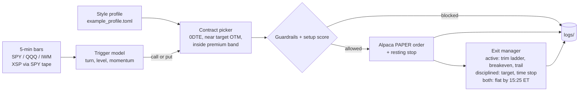

# options-mimic-bot

**An educational 0DTE options signal bot with behavioral guardrails that trades only on Alpaca's free _paper_ (simulated) environment.**

`Status: educational / experimental` · `Python 3.11+, stdlib only` · `License: MIT`

> **Disclaimer.** This project is for education and research only. It is **not financial advice**, not a recommendation to buy or sell any security, and not an offer of any service. It is built for **paper trading only**: the trading URL is hard-wired to `https://paper-api.alpaca.markets` and the bot refuses to start against anything else. Options, especially 0DTE options, can lose 100% of their value quickly. All numbers in `config/example_profile.toml` and `mimic_bot/ranking.py` are **placeholders**, not tested or recommended settings. The software is provided "as is", **without warranty of any kind** (see `LICENSE`). Use at your own risk.

## What it does
- **Style profile config.** `config/example_profile.toml` describes a trading style: 0DTE single-leg calls/puts, strike near a target % OTM, a premium band, and three profiles: `mimic` (loose, guardrails mostly off, for comparison), `disciplined` (strict) and `active` (default for paper mode).
- **Trigger-based entry signals.** `mimic_bot/triggers.py` reads 5-minute price action: dip-and-turn, VWAP / prior-day / round-number level touches, momentum, opening drive, late-day moves.
- **Setup score.** `mimic_bot/ranking.py` gives each signal a 0-1 score from simple priors (trigger type, level, time of day, symbol, with/against the day's trend). The priors are examples; replace them with your own results.
- **Guardrails** (`mimic_bot/guardrails.py`): entry windows, max trades per session, cooldown after a loss, no size-up after a loss, premium floor, per-trade risk cap, max open positions per symbol, daily loss limit, no earnings holds.
- **Alpaca paper trading.** `python run.py --paper` runs the loop on Alpaca's paper environment only, with a resting stop on every fill, a trim-ladder exit plan, a trailing stop, and every event logged to `logs/`.
- **Suggest-only mode.** `python run.py suggest` prints a ticket. Nothing is sent anywhere.
- **Backtester.** `mimic_bot/backtest.py` runs a rough backtest on 10-minute bars with Black-Scholes-approximated option prices (bring your own bar data).

## How it works


## Setup
```
git clone <this repo URL> options-mimic-bot && cd options-mimic-bot
python3 -m venv .venv && .venv/bin/pip install pytest
.venv/bin/python -m pytest -q          # all tests are mocked: no keys, no network
```

### Set your own risk settings first
Copy the example config and edit it:
```
cp config/example_profile.toml config/my_profile.toml
export MIMIC_BOT_CONFIG=config/my_profile.toml
```
`[exit].stop_loss_pct` is **required** and has no built-in default. It is a negative fraction of the entry premium (for example `-0.25` means "sell if the option loses 25% of what I paid"). The value in the example file is only an example. The bot refuses to load a config without a valid stop. Review every other number too (sizing, `portfolio_fraction`, `max_risk_pct_of_account`, `daily_loss_limit_pct`, the trim ladder, `min_score`).

### Paper trading on Alpaca
1. Make a free Alpaca account and create **paper** API keys (Paper account → API Keys).
2. Provide them as environment variables, either exported in your shell or in a `.env` file (gitignored):
   ```
   cp .env.example .env     # then fill in APCA_API_KEY_ID and APCA_API_SECRET_KEY
   ```
   Never commit keys. Live keys won't work: only `paper-api.alpaca.markets` is accepted.
3. `python3 run.py --paper --check` does a read-only account check (status, equity, options level, market clock). It places nothing.
4. `python3 run.py --paper` runs the loop with the `active` profile. `--once` runs one pass and exits. `--symbols SPY,QQQ` changes the watchlist. `--profile disciplined` switches to the strict profile.
5. `scripts/run_paper_day.sh` runs it unattended until 16:05 ET with crash restarts and a single-instance lock (`STOP_AT=HH:MM` in ET to change).

If the paper account has no options approval (level 2+), the bot falls back to signal-only mode and logs `would_buy` events.

### Other commands
```
python3 run.py suggest --triggers --symbol SPY     # needs your own data/bars_5m.json
python3 run.py backtest --profile disciplined       # needs your own data/underlying_10m.json
python3 run.py compare                              # mimic vs disciplined, fade vs raw
```
Bar data is not included. Formats are documented in `mimic_bot/triggers.py` (`load_bars`) and `mimic_bot/backtest.py` (`load_bars_10m`). `data/` is gitignored.

## How paper mode behaves
- Trading URL hard-wired to `https://paper-api.alpaca.markets`; any other `APCA_API_BASE_URL` is refused (and never echoed, since it could contain credentials). Bars and option quotes are read-only GETs from `https://data.alpaca.markets`.
- Entry is a limit buy at the ask. `active` sizes premium outlay as `portfolio_fraction` of paper equity; `disciplined` buys 1 contract and also applies `max_risk_pct_of_account`.
- After a fill, a resting sell-stop goes in at your `stop_loss_pct`. If Alpaca paper rejects it, the loop watches the bid and exits itself.
- `active` exits with a trim ladder (`trim_ladder_gains` / `trim_fractions`), moves the stop to breakeven after the first trim, and arms a trailing stop at `trail_arm_pct`. `disciplined` uses a profit target and a time stop. Everything is flat by 15:25 ET.
- No size-up after a loss, a cooldown after a loss, an optional hourly catch-up with its own score floor and smaller size, and a daily loss limit that survives restarts.
- Orders carry deterministic `client_order_id`s, Alpaca timeouts / 429s / 5xx are retried with backoff, and restarts reconcile with the paper account (adopt unknown positions and stop them, close out missing ones, cancel stale buys). State lives in `logs/paper_state.json` (atomic writes); events go to `logs/paper_YYYY-MM-DD.jsonl`.
- **XSP instead of SPX:** full-size SPX 0DTE contracts are expensive; XSP is 1/10 the size and cash-settled. `--symbols SPX` maps to XSP, and XSP signals use SPY's tape.

## Project layout
| Path | What |
|---|---|
| `run.py` | CLI for backtests, suggestions and paper mode |
| `config/example_profile.toml` | Example style profile and the three trading profiles (placeholders) |
| `mimic_bot/triggers.py` | Trigger-based entry logic |
| `mimic_bot/ranking.py` | Setup score (example priors) |
| `mimic_bot/guardrails.py` | Pre-trade checks |
| `mimic_bot/signals.py` | Simple fade signal used by the backtester |
| `mimic_bot/backtest.py`, `mimic_bot/pricing.py` | Rough backtest with Black-Scholes pricing |
| `mimic_bot/broker.py` | `PaperBroker` (backtest) and `LiveOrderTicket` (suggest-only, sends nothing) |
| `mimic_bot/broker_alpaca_paper.py`, `mimic_bot/paper_loop.py` | Alpaca paper client and the paper loop |
| `mimic_bot/scoreboard_lens.py` | Annotates suggestions with a momentum/balanced label and SPY 200-day regime |
| `scripts/run_paper_day.sh` | All-day paper launcher |
| `tests/` | Mocked tests (no network); CI config in `ci/tests.yml` |

## License
MIT. See `LICENSE`. No warranty.
